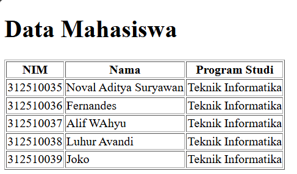
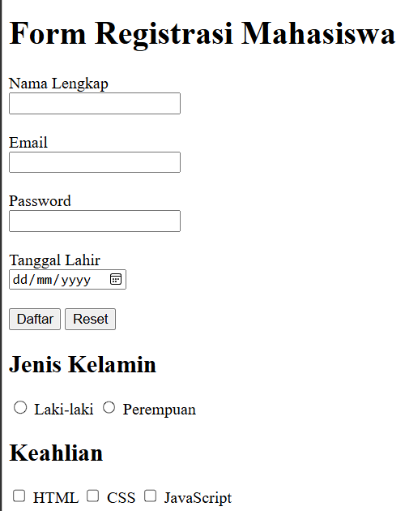
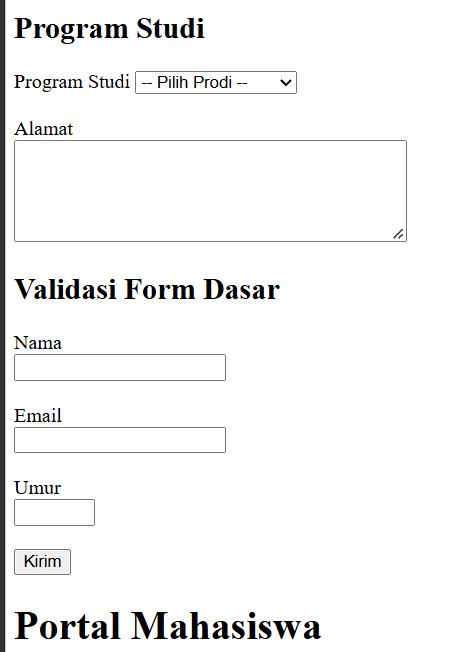
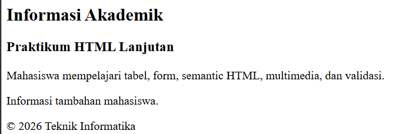
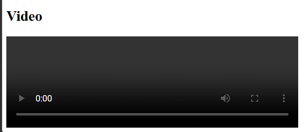

# Lab2Web
# Praktikum 2 - HTML Lanjutan

---

## Identitas

* **Nama:** Noval Aditya Suryawan
* **NIM:** 312510035
* **Program Studi:** Teknik Informatika
* **Universitas:** Universitas Pelita Bangsa
* **Mata Kuliah:** Pemrograman Web

---

## Deskripsi Praktikum

Pada praktikum ini, saya mempelajari penggunaan HTML lanjutan untuk membuat halaman web. Materi yang dikerjakan meliputi tabel, formulir, validasi input, elemen semantik, penambahan audio dan video, serta pembuatan halaman biodata mahasiswa.

---

## Tujuan Praktikum

1. Memahami penggunaan tabel pada HTML.
2. Membuat formulir dengan berbagai jenis input.
3. Memahami validasi pada formulir.
4. Mengenal elemen semantik HTML.
5. Menambahkan audio dan video ke halaman web.
6. Membuat halaman biodata menggunakan HTML.
7. Mengunggah hasil praktikum ke GitHub.

---

## 1. Tabel Data Mahasiswa

Pada bagian ini, saya membuat tabel data mahasiswa menggunakan elemen HTML `<table>`, `<tr>`, `<th>`, `<td>`. Saya juga membuat tabel nilai praktikum yang menampilkan nilai mahasiswa dan rata-rata.

---

## 2. Form Registrasi Mahasiswa

Form registrasi dibuat menggunakan input nama lengkap, email, password, tanggal lahir, tombol daftar, dan tombol reset.

---

## 3. Select, Textarea, dan Validasi Form

Pada bagian ini, saya menggunakan elemen `<select>` untuk pilihan program studi dan `<textarea>` untuk mengisi alamat. Saya juga membuat validasi form menggunakan atribut HTML seperti `required`, `minlength`, `min`, dan `max`.

---

## 4. Elemen Semantik HTML

Menggunakan elemen semantik seperti `<header>`, `<nav>`, `<main>`, `<section>`, `<article>`, `<aside>`, dan `<footer>` untuk menyusun struktur halaman web yang lebih rapi.

---

## 5. Menambahkan Audio

Elemen `<audio>` digunakan untuk menampilkan pemutar audio di halaman web. Pengguna dapat memutar dan mengatur volume audio melalui kontrol yang tersedia di browser.

---

## 6. Menambahkan Video

Elemen `<video>` digunakan untuk menampilkan video langsung pada halaman web. Pemutar video menyediakan kontrol untuk memutar, menjeda, dan mengatur tampilan video.

---

## 7. Halaman Biodata Mahasiswa

Halaman biodata dibuat dalam file `biodata.html`. Halaman ini menampilkan navigasi, tabel data mahasiswa, dan formulir biodata.

